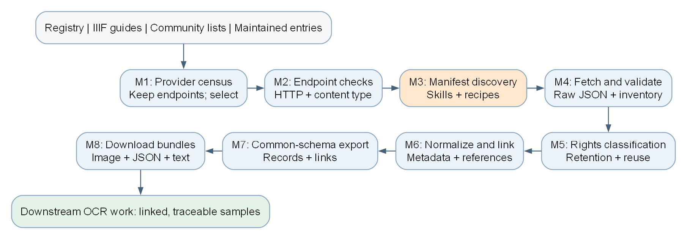
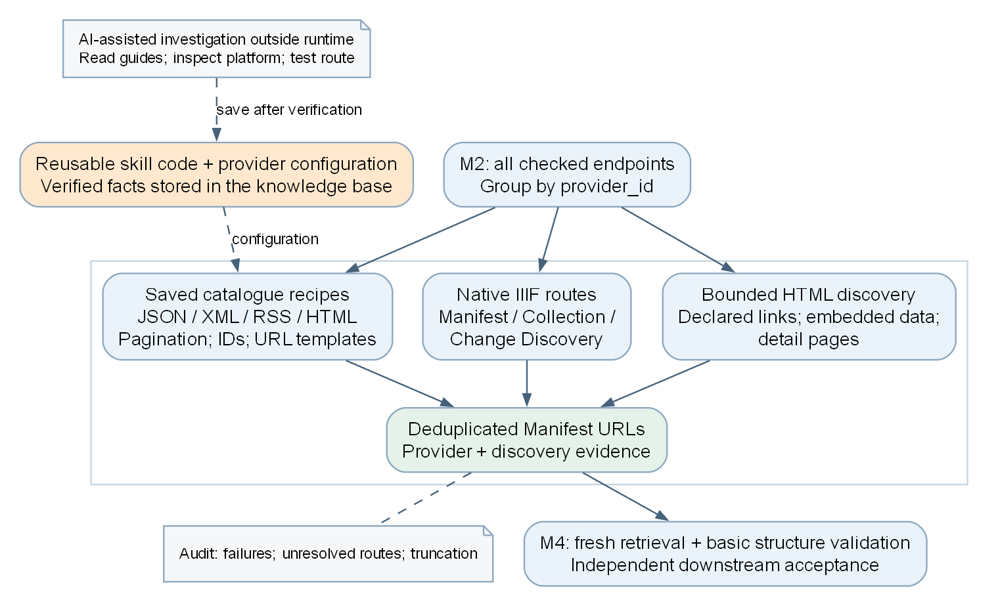
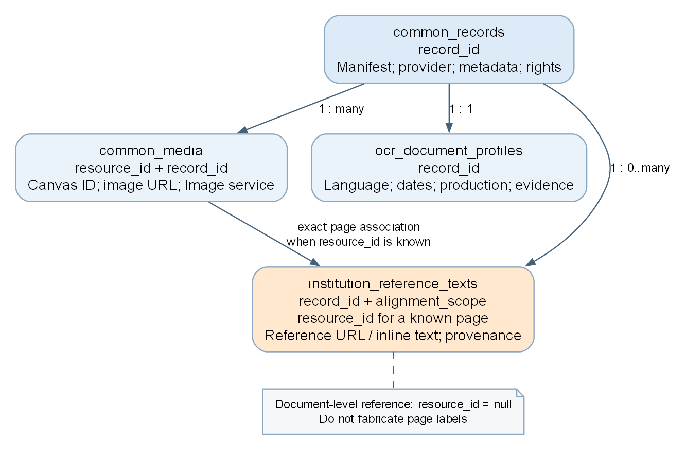
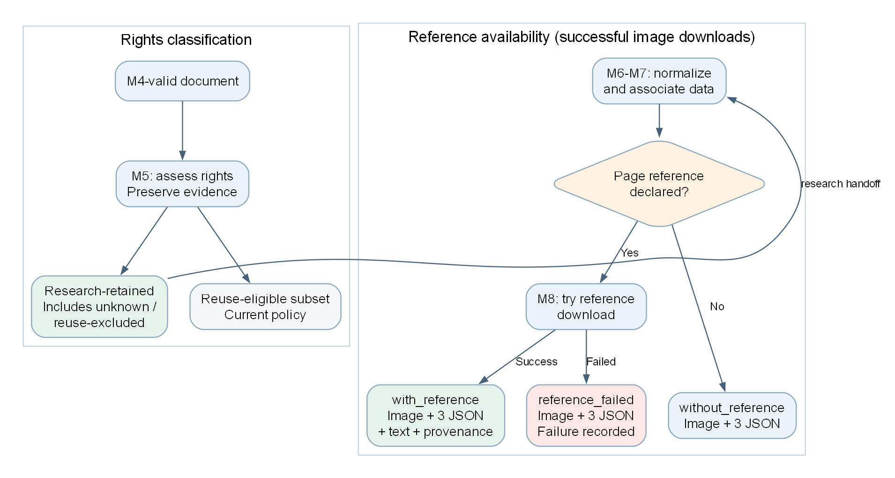

## 1. 中期结论与任务范围

**我们已经实现 Module 1-8 和统一运行器，并通过真实资源验证了从机构入口到文献、图片及机构参考文本的完整数据链路。当前主要瓶颈是 Module 3 对不同入口的发现能力和完整目录枚举，而不是其余模块尚未搭建。**

项目目标是把分散的文化遗产资源整理成统一、可追溯、保留权利信息的数据，交给 Arsha 等下游成员使用。我们的主要职责是采集与交接；本项目当前没有开发 OCR 引擎，也没有完成所有资源的人工标准答案制作。一份 Manifest 可描述一本书或数字对象，包含多页。

本报告依据本地代码、配置、运行日志和已有文件核对，**没有在 11 月 2 日重新联网收割全部来源**。教授最新邮件将中期汇报安排在 11 月 9-10 日，本组具体时段和地点仍待确认。

### 1.1 已完成的核心工作

| 阶段 | 模块与主要成果 | 交接内容 |
|---|---|---|
| 来源与检查 | M1 保留机构、来源及多个候选入口；M2 逐入口检查 | 机构清单、HTTP/内容类型/解析结果 |
| 发现与获取 | M3 调用通用方法和机构配方；M4 获取并校验 Manifest | Manifest URL、原始 JSON、图像资源清单 |
| 权利与整理 | M5 区分研究保留和公开再利用；M6 提取规范化字段 | 文献、图像、参考文本及原始证据 |
| 统一交付 | M7 校验关联与数据格式；M8 下载独立样本包 | 图片、配套 JSON、可用机构文本及日志 |

另有独立配置、自动测试、阶段日志、命令行说明和英文 README。运行器可按配置顺序执行，并从指定模块继续。

{width=100%}

\newpage

## 2. 技术难点与 Module 3 的改进

### 2.1 问题为什么集中在发现阶段

IIIF 规范统一了资源的描述和访问方式，但输入的机构首页不一定提供可以直接遍历的目录。Manifest 可能位于具体藏品页，也可能需要先通过机构目录 API 获取 ID。最初只保留少量入口、网页遍历预算过小，以及缺少平台目录处理，都会漏掉已有资源。

**EPFL Plume 是这一问题的实例：具体藏品页已经有 IIIF 链接，初版没有发现，不能解释为 Plume 没有 IIIF。** 后续通过 Omeka S 目录 API 枚举记录 ID，再访问经过验证的原生 Manifest 路线，是提高枚举效率的一种方法，而不是替代 IIIF 的专有格式。

### 2.2 我们已经怎样修改

1. M1 保留多个入口和来源证据，M2 分别检查，M3 按机构组织全部检查结果。
2. 支持直接 Manifest、Collection 成员/嵌套/分页、Change Discovery、HTML 与嵌入数据等路线。
3. 增加 JSON、HTML、XML/RSS/OAI 目录处理，以及分页、ID 提取、详情展开和 Manifest URL 模板。
4. 将方法写在可复用代码中，将 URL、字段路径、分页参数、模板与机构范围放入配置。
5. 保存成功、失败、截断和调查依据；共享平台使用机构范围配置，避免翻页后进入其他机构的目录。

{width=94%}

### 2.3 知识库的实际作用与边界

当前有 **73 条机构知识配置、19 条预设入口配置**，两者可能重叠。另存有指定官方指南版本中 69 条机构/资源条目的文档证据；这些文档记录不等于全部已经实现的批量配方。

AI 已用于辅助调查、开发和提出候选路线。验证后的已知配方由确定性代码执行；**尚未接入运行时 AI API，为任意新机构自动检索资料、生成并验证新配方的流程仍未完成**。现有成果说明方法可以复用，不能证明对所有陌生机构都能自动泛化。

\newpage

## 3. 最终输出与对下游的价值

### 3.1 文献、图片和文本如何关联

| 交付文件 | 主要用途与关联键 |
|---|---|
| `common_records.jsonl` | 文献主记录；用 `record_id` 保存 Manifest、机构、元数据和权利 |
| `common_media.jsonl` | 具体图像；有 `resource_id`、`record_id`、Canvas ID、下载地址和服务信息 |
| `ocr_document_profiles.jsonl` | 文献级 OCR 画像；通过 `record_id` 关联语言、日期、制作方式及依据 |
| `institution_reference_texts.jsonl` | 机构 OCR/转录；保留来源与范围，有明确页面关联时记录 `resource_id` |

{width=84%}

OCR 画像主要由元数据和规则提取。没有元数据支持的语言、字体或制作方式保留为未知；渗墨、破损、微缩胶卷等扫描状况尚未对全体图片作视觉评估。

### 3.2 权利与参考文本分别处理

当前项目策略将 unknown 和公开再利用被 exclude 的资源保留在研究下游，同时保存原始权利证据与限制；exclude 不表示从研究数据删除，unknown 也不等于无版权。共同数据模式仍为有版本的暂定模式，最终需要与团队交接要求对齐。

M8 每张成功下载的图均附带文献、图像、OCR 画像三份 JSON，并按实际文本获取结果分类：

- `with_reference`：至少成功获取一份关联机构文本，另附原始文本、纯文本与来源 JSON。
- `without_reference`：没有识别出的可用于该页的参考文本声明。
- `reference_failed`：识别到关联声明，但没有成功获取文本；失败原因保留。

是否允许公开再利用，与是否有参考文本是两个独立维度。有参考文本不自动改变权利，也不保证文本经过人工校正。

\newpage

## 4. 当前结果与验证证据

### 4.1 来源覆盖：累计历史证据

| 来源范围 | 已验证条目 | 未完成条目 | 合计 |
|---|---:|---:|---:|
| 最初清单 | 67 | 27 | 94 |
| 后续补充的来源 | 33 | 0 | 33 |
| **当前合计** | **100** | **27** | **127** |

这是累计有界测试的来源条目数，包含项目、聚合平台和同机构的不同条目；**不是去重后的 100 家机构，不是统一留出集上的成功率，也不是 100 个完整馆藏**。原始清单中的 27 条并没有因扩充清单而自动解决。

### 4.2 最新同批实测：2026 年 10 月 22 日

| 机构 | 有效 Manifest | 图像关联记录 |
|---|---:|---:|
| 柏林中央与州立图书馆 | 6 | 9 |
| 柏林洪堡大学图书馆 | 6 | 2,000 |
| 基尔市档案馆 | 6 | 7 |
| 基尔大学图书馆 | 6 | 938 |
| 德累斯顿 SLUB | 6 | 648 |
| 卡塞尔大学图书馆 | 6 | 22 |
| 上奥地利州立图书馆（林茨） | 6 | 3,499 |
| **合计** | **42** | **7,123** |

M2 的 7 个入口均可达，其中 6 个是 XML，1 个是原生 Collection JSON。M4 重新获取 42 份并全部通过基本结构校验，缓存命中为 0。M5-7 导出 42 条文献、7,123 条图像关联和 42 份 OCR 画像；**最终实际下载 7 张样例图与 21 份基础 JSON**。

每家本轮只取 6 份 Manifest。五家 RSS 配方只覆盖最多 50 条公开 feed 记录，没有已验证的全目录分页；德累斯顿另验证了 OAI 第二页；林茨所选 Collection 声明 466 个成员，本轮仍只抽取 6 个。不能据此推断全馆总量。

### 4.3 两类测试各自证明什么

**模块与交接：** 10 月 19 日的上传副本验收，八模块和运行器共 194 项测试、12 个子测试通过，BSB、FromThePage、EPFL 三组固定种子完成真实链路。它证明交接可运行，不是任意首页发现能力评估。

**最新发现与交付：** 10 月 22 日 M3-8 的 193 项测试及 7 个子测试通过；7 张最终图片均可解码，21 份 JSON 通过结构与 ID 关联校验。测试范围和版本不同，两组数量不相加。

\newpage

## 5. 真实样例、现存问题与下一步

### 5.1 可展示的机构图像—OCR 配对

最新林茨样例对应 `AC05304281` 的 Canvas 21，保存了图片、三份基础 JSON、机构 ALTO XML、纯文本及参考来源 JSON。**图像与 ALTO 页面均为 2882×4629，159 个词框均在图像范围内**。

6 份林茨 Manifest 中共有 3,504 条参考文本描述，其中 3,498 条与具体图像关联，6 条属于文献整体。本轮只实际下载并核验了上述一份正文文本，不能将所有描述地址视为已经下载且准确的标签。

此案例证明图像—文本交接和坐标对应可以工作；转录准确率和人工校正状态尚未认证。BSB hOCR、FromThePage 转录和无页面参考的 EPFL 也有历史全链路证据。

### 5.2 已知限制

- **未知机构调查仍依赖人工与 AI 辅助。** 已知配方可自动执行，新配方的产生和可靠验证尚未形成自主运行系统。
- **发现与完整枚举是两项能力。** 查询子集、RSS 上限、分页范围和运行预算会限制覆盖，需要逐路线记录。
- **图像可用不等于原始分辨率。** 多站 Manifest 给出 300-400 像素预览；最新样例通过显式 Image 服务辅助步骤取得清晰版本，但生产 M7/M8 默认尚未统一优先高清。德累斯顿该服务本身仅提供 1000×1509。
- **参考文本覆盖不完整。** 外部 AnnotationList/AnnotationPage 的抓取尚未完整覆盖，整本文本也不一定能拆成逐页标签。
- **访问和来源故障仍存在。** 超时、404、访问限制或单个外部图像失败，不证明机构没有 IIIF；失败结果不能计入成功。

### 5.3 下一阶段优先工作

1. 固定可演示的数据切片和小规模复现命令，供 Arsha 检查交接，并完成中期展示。
2. 为每条配方补充目录范围、分页能力和停止原因，优先补足有价值目录的完整枚举。
3. 将未知机构调查整理为可独立运行的流程；若接入 AI API，只让 AI 提出候选路线，仍以确定性检查决定是否保存。
4. 扩展页面级参考文本与图像表示的处理，做独立的质量抽样；与团队确认最终数据模式。

截至中期，主要成果是**已有可执行、可追溯的端到端采集与交接系统，以及保存了证据的机构发现方法**。后续评价应更关注新来源接入成本、目录完整度和下游可用性，而非仅增加机构数量。

\newpage

## 6. PPT 或报告应该放哪些流程图

建议主讲材料保留下面 **4 张核心流程图**。图1-3已在前文给出，图4见下页；全部提供 PNG、SVG 和可编辑 DOT 源文件。单页只回答一个主要问题，避免把所有模块内部函数都画进去。

### 图1：整条流水线结构图（必放）

**要回答：输入是什么，经过哪些阶段，最终交给下游什么？**

应包含四类来源、M1-8 各一句职责、关键交接数据，以及最终图片/JSON/参考文本。用箭头表达数据流，运行器与日志作为旁注；高亮 M3，但不将其他模块隐去。口头讲三个阶段即可：来源与发现、校验与整理、统一交付。

**结论：** 完整链路已实现，图像和文本可以沿统一接口交付。

### 图2：Module 3 的发现与知识复用图（必放）

**要回答：面对不同机构，我们如何找到 Manifest，哪些部分可以复用？**

应包含 M2 全部入口按机构分组、原生 IIIF 路线、JSON/XML/RSS/HTML 目录配方、受限 HTML 发现、通用操作与机构配置、URL 去重及证据记录、独立 M4 校验。标出失败和截断。

AI 辅助调查画在运行流程之外，调查后经验证才保存配置。当前各方法按配置和已有结果选择执行，不声称每个入口都会无上限地尝试所有方法；图中的并列框是能力类别，不是固定代码执行顺序。

**结论：** 已实现方法与机构事实的分离；未知平台的自动调查仍是待完成部分。

### 图3：文献—图像—OCR 画像—参考文本关联图（必放）

**要回答：Arsha 如何知道一段文字对应哪张图、哪份文献？**

应包含四类交付文件及关键字段：文献 `record_id`；图像 `resource_id`、`record_id`、Canvas ID 与下载地址；画像 `record_id` 与元数据依据；参考文本的 `record_id`、页面关联、来源地址、格式和对齐范围。标注一份文献对应多张图片，而画像是文献级。

整本文本无法确定页面时，将 `resource_id` 标为 null，不画一条虚假的逐页关联。

**结论：** 下游能够通过明确的 ID 使用图片和文本，而不必从标题或文件名猜配对。

### 图4：权利保留与参考文本交付分流图（必放）

**要回答：unknown/exclude 是否被丢弃？没有文本、文本失败时分别去哪？**

上半部分包含 M5 的研究保留主线和公开再利用子集，下半部分包含 M6-7 的关联导出及 M8 的三个文件夹。标明 with_reference 需要成功取得文本，reference_failed 必须留失败记录。

权利资格与参考文本可用性是独立维度，不要将 unknown/exclude 都画到“无参考文本”，也不要把有参考文本画成自动允许公开传播。图4展示成功下载图片的目录分流，图片本身下载失败另入失败日志。

**结论：** 保留数据与证据，同时避免混淆使用限制、缺失文本和下载失败。

\newpage

{width=100%}

### 图5：一个机构的实际访问链路（可选）

选 EPFL 或林茨中的一个，展示具体可核验的路线，不要把多个机构拼成一条不存在的流程。

- **EPFL 案例：** 官方指南/平台证据 → Omeka S 目录 API → `o:id` → 原生 Manifest → Canvas → 声明的 Image 服务 → 图片。另注明藏品页也可直接暴露 Manifest，API 是批量枚举方法之一。
- **林茨案例：** 原生 Collection → 声明的 Manifest → Canvas 21 → 图像服务和 ALTO → 下载文件 → 尺寸/关联验证。图像旁放 159 词 OCR 的简短节选与相同 Canvas ID。

**结论：** 从入口到最终样本有证据链，不是只展示一个看起来合理的 URL。

### 图6：下一阶段 AI 辅助调查闭环（可选，只能标为计划）

内容可为：未知来源 → 收集官方文档与页面证据 → AI 提出候选配方 → HTTP/JSON/IIIF/图像校验 → 成功后保存配置或失败后记录原因 → 对新来源测试。

整图使用虚线或单独颜色，并标注 **Proposed / Not yet implemented**。AI 不能直接把未经验证的 URL 写成已确认知识；不要把该图冒充目前已有的自主系统。

## 7. 还需要两张统计图，而不只是流程图

**统计图A：来源覆盖组成。** 分为“原始清单：67 已验证＋27 未完成”和“后补来源：33 已验证”，总计127。标注累计历史证据和条目口径；不直接标为陌生机构的泛化成功率。

**统计图B：最新七机构样本的图像关联数量。** 使用同批 `provider_results.csv`，分别为9、2000、7、938、648、22、3499。纵轴注明图像关联记录；图注写每家6份 Manifest、共42份，实际仅下载7张样图。数值差距大时用清楚的数值标签或注明对数轴，不用一张漏斗图混合机构数、文献数和图片数。

如需讲成功率，只报告范围明确的量：本批 M4 的42/42、最终样图7/7、配套JSON 21/21。这些不等于全馆图像可下载率或未知机构泛化率。

\newpage

## 8. 建议展示顺序与证据入口

幻灯片可按下列顺序安排，具体页数和时长以老师后续要求为准：

1. 任务目标及团队交接；2. 整体流水线；3. M3 难点与复用设计；4. 来源范围和同批结果；5. 关联输出及实际图文样本；6. 权利与下载分流；7. 局限与后续计划。

图5可并入样本页；图6放未来工作或备用页。主讲不需要逐一介绍所有函数，也不应把“保存了更多机构配置”讲成“机器已学会自主发现所有机构”。

### 本地证据

- [最新七机构实测说明](../../../Code_git/Module_3/evaluation/2026-10-22_third_seven_provider_completion/本轮七机构验证结果_100来源.md)
- [同批逐机构统计 CSV](../../../Code_git/Module_3/evaluation/2026-10-22_third_seven_provider_completion/provider_results.csv)
- [累计来源状态](../../../Code_git/Module_3/evaluation/2026-10-22_third_seven_provider_completion/cumulative_provider_status.csv)
- [最新测试记录](../../../Code_git/Module_3/evaluation/2026-10-22_third_seven_provider_completion/test_results.json)
- [图文尺寸与词框核验](../../../Code_git/Module_3/evaluation/2026-10-22_third_seven_provider_completion/reference_alignment_verification.json)
- [林茨图片、三份 JSON 与机构文本样本包](../../../Code_git/Module_3/evaluation/2026-10-22_third_seven_provider_completion/download_examples/module8/output/all/with_reference/manifest-0e0173792b2ca81e/000020_resource-5a1740085010f7233fd1/)
- [历史八模块全链路验收](../../../Code_git/Pipeline_Runner/verification/2026-10-19.json)
- [可复制的最新批次运行命令](../../../Code_git/Module_3/evaluation/2026-10-22_third_seven_provider_completion/运行命令.txt)
- [机构方法与局限记录](../../../Code_git/Module_3/knowledge/implementation-status-and-lessons.md)

上述路径相对本 Markdown 源文件。独立 PDF 中的本地链接未必能被阅读器打开，应从项目目录或源文件导航，不作为公开分享链接。四张图的 SVG、PNG、DOT 位于同目录的 `figures/2026-11-02/`，可用于制作 PPT。
