# Speaker script and figure guide

**Guide page 1 of 8 | Deck slides 1-3 | 6 November 2026**

Read the **Spoken** paragraphs for the main presentation. Figure notes and optional slides support questions. Slide numbers follow the 13-page deck. Positions refer to the slides, in clockwise order: **upper-left, upper-right, lower-right, lower-left**; empty positions are omitted.

## Slide 1 | One Door to a Scattered Heritage

**Spoken.** Hello, I am Boheng Shang. My project collects scattered digital heritage resources and prepares linked images, metadata and institutional reference texts for downstream OCR work. Today I will present the pipeline, its current evaluation, a download demonstration and the next development steps.

## Slide 2 | The eight-module pipeline

**Central diagram.** M1 selects sources; M2 checks endpoints; M3 discovers Manifest URLs; M4 retrieves and validates them; M5 classifies rights; M6 extracts metadata and references; M7 exports linked records; M8 downloads images and available texts.

**Spoken.** A Manifest is a JSON description of a digital object and its presentation resources, including pages represented as Canvases. The pipeline separates discovery, validation and delivery into eight modules. Each stage preserves its outputs and logs. The final handoff contains images, document information and page-linked institutional text when available. My contribution prepares the data; it does not perform OCR itself.

*Before presenting: the overview still contains copied M1/M2 labels inside M7/M8. Their correct roles are Common-Schema Export and Image and Reference-Text Download. The M5-6 group is Rights Classification and Metadata Extraction.*

## Slide 3 | Experimental setup and overall results

<div class="figure-inline">
<figure>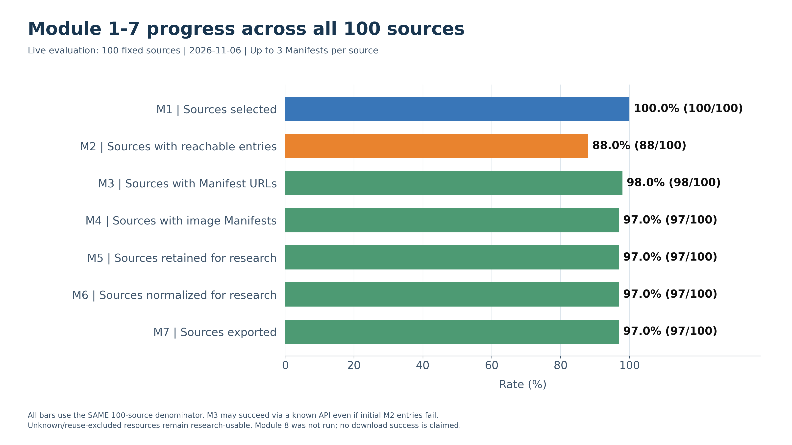<figcaption>Upper-left | Figure 00: all bars use 100 sources.</figcaption></figure>
<div><p><strong>Setup:</strong> 100 previously validated source entries; 139 supplied endpoints; up to three Manifests per source; M1-7 executed; fresh M4 retrieval; LLM disabled; no M8 downloads in this evaluation.</p><p><strong>Results:</strong> M1 selected 100 sources; M2 found reachable supplied entries for 88; M3 found Manifest URLs for 98; M4-7 produced image-document outputs for 97.</p><p><strong>Units:</strong> 275 source-specific document records correspond to 269 distinct Manifest URLs. The 44,915 image associations are exported records, not downloaded images.</p></div>
</div>

**Spoken.** I retested a fixed set of 100 previously validated sources, checking all 139 supplied endpoints and processing at most three Manifests per source. Module 8 was excluded from this evaluation. Discovery succeeded for 98 sources, and 97 produced downstream image-document outputs. The result was 275 source-specific document records and 44,915 image associations. This measures current coverage of known sources under a bounded sample, rather than complete catalogues or generalization to unseen institutions.

<div class="pagebreak"></div>

# Entry checks and Manifest discovery

**Guide page 2 of 8 | Deck slides 4-5**

## Slide 4 | Modules 1 and 2

<div class="figure-strip">
<figure>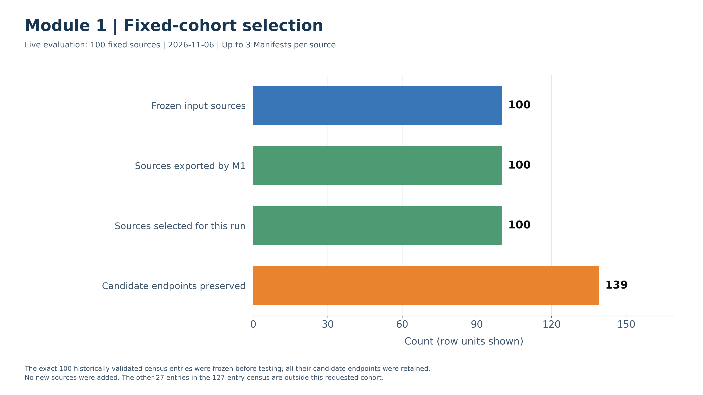<figcaption>Upper-left | Figure 01: census and selection.</figcaption></figure>
<figure>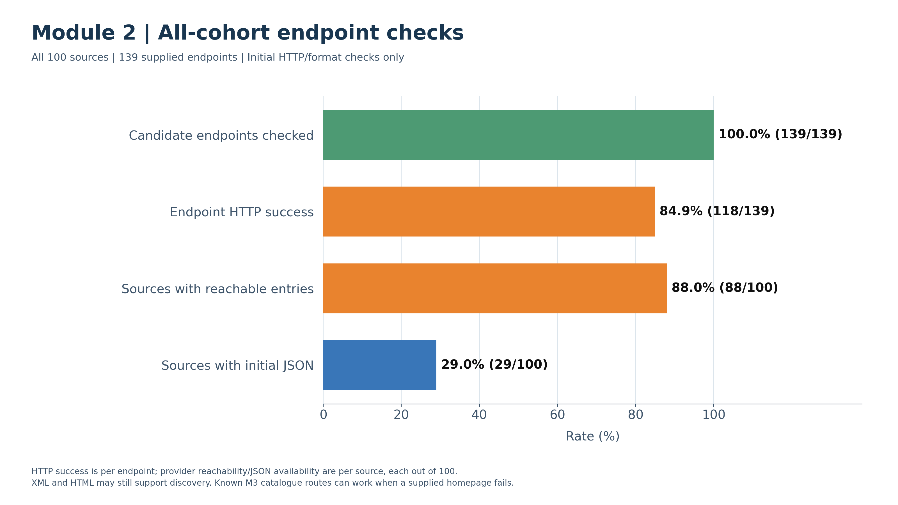<figcaption>Upper-right | Figure 02: initial endpoint checks.</figcaption></figure>
</div>

**Figure notes.** The left chart shows 100 frozen inputs, 100 exported sources, 100 selected sources and 139 preserved endpoints. This is successful input preparation, not proof that every URL works. The right chart separates checking coverage, 139/139, from HTTP success, 118/139 or 84.9%. Reachability is per source, 88/100; initial JSON is available from 29 sources. These denominators must remain separate.

**Failures.** The 21 unsuccessful endpoint checks include access/authentication responses (9), rate limiting (1), HTTP 404 (4), HTTP 400/405 (3), HTTP 502 (1), an incomplete redirect (1), and client/network errors (2). Some input URLs were malformed or still contained a template placeholder; those require input/handling fixes.

**Spoken.** Module 1 combines the source lists while preserving multiple candidate endpoints and their provenance. Module 2 checks every supplied endpoint and records HTTP status, response time, content type and JSON parsing. All 139 endpoints were checked, and 118 returned successful responses. Eighty-eight sources had a reachable supplied entry. An HTML or XML response can still support resource discovery, so the absence of initial JSON does not mean that a source is unusable.

## Slide 5 | Module 3

<div class="figure-inline small">
<figure>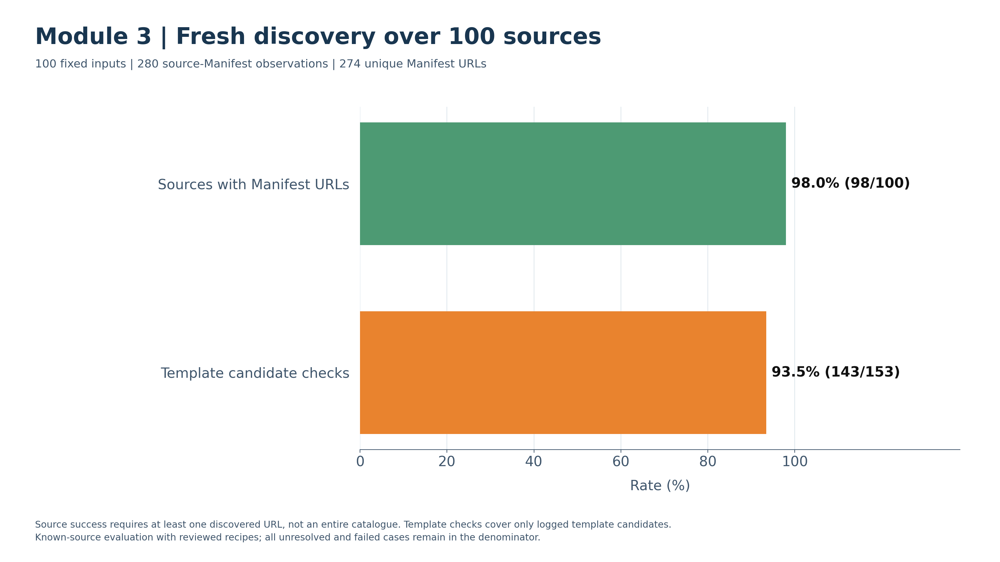<figcaption>Upper-left, first animation | Figure 03.</figcaption></figure>
<div><p><strong>Discovery:</strong> 98/100 sources; 280 source-Manifest observations; 274 distinct Manifest URLs. A shared URL may appear under more than one source entry.</p><p><strong>Template-check bar:</strong> 143/153 audited catalogue/template candidate checks succeeded (93.5%). The ten unsuccessful checks are candidate checks, not ten failed sources. This strategy-specific denominator differs from both 100 sources and 280 observations.</p><p><strong>Lower-left, later animation:</strong> Figure 12 ranks sampled image yield. Its clean preview and detailed explanation appear on guide page 7. Treat the overlapping PDF images as separate animation states.</p></div>
</div>

**Spoken.** Module 3 combines direct Manifest detection, Collection pagination, Change Discovery, HTML links and catalogue recipes using JSON or XML. The reusable operations include pagination, identifier extraction and URL templates. For EPFL Plume, the Omeka S catalogue API supplies item identifiers that lead to standard IIIF Manifests; the item pages also expose IIIF links. In the current run, Leipzig encountered a client/network error, while Wales returned an access-denied response and a catalogue timeout. Their previous successful routes remain evidence of historical access, but this run did not resolve them.

<div class="pagebreak"></div>

# Validation, rights and normalization

**Guide page 3 of 8 | Deck slides 6-7**

## Slide 6 | Module 4

<div class="figure-inline small">
<figure>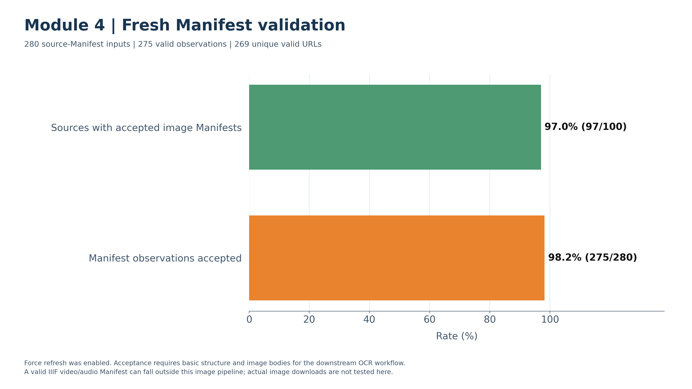<figcaption>Upper-left | Figure 04: two different denominators.</figcaption></figure>
<div><p><strong>Source coverage:</strong> 97/100 sources supplied accepted image Manifests.</p><p><strong>Record acceptance:</strong> 275/280 observations, or 98.2%, passed the image pipeline; 269 distinct Manifest URLs remain.</p><p><strong>Lower-left table:</strong> repeats these counts and reports 44,915 image associations inventoried from the accepted records.</p></div>
</div>

**Spoken.** Module 4 retrieves the raw Manifest, checks its basic IIIF structure and inventories its image resources. It accepted 275 of 280 observations. Three Northwestern samples contained no image bodies; one Austrian National Library request returned HTTP 400, and one Trier Seminary Library request returned HTTP 404. Austria and Trier still contributed other accepted records. A non-image Manifest may be valid IIIF while falling outside this image-oriented workflow. The sampling strategy should continue looking for suitable image content instead of stopping after any three results.

## Slide 7 | Modules 5 and 6

<div class="figure-strip">
<figure>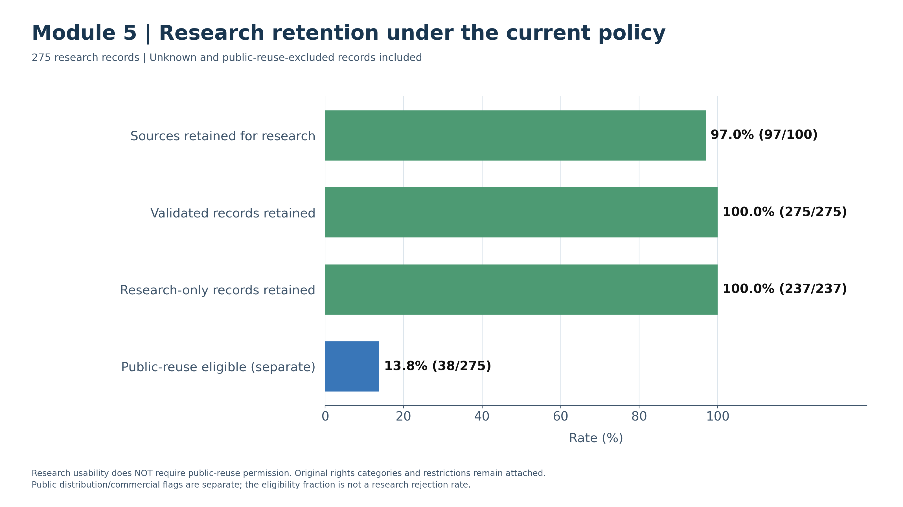<figcaption>Upper-left | Figure 05: rights and retention.</figcaption></figure>
<figure>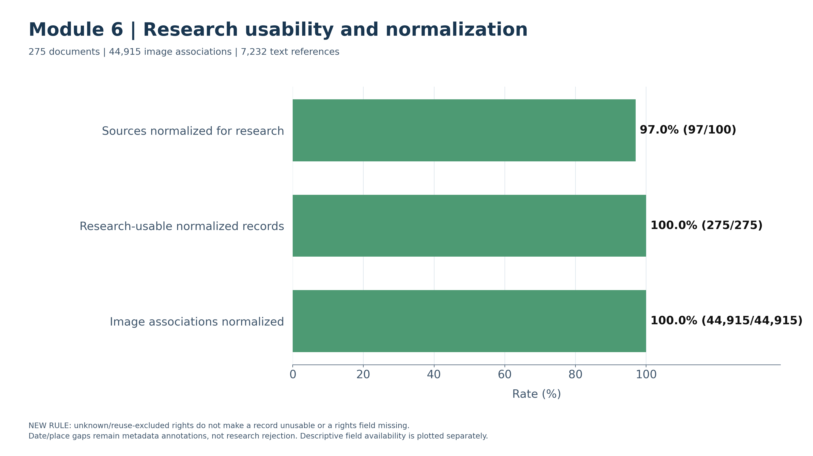<figcaption>Upper-right | Figure 06: normalized research output.</figcaption></figure>
</div>

**Figure notes.** Source coverage remains 97/100. Conditional retention is 275/275 accepted records; all 237 public-reuse-excluded records remain in the research output. The blue bar, 38/275 or 13.8%, describes public-reuse eligibility under the current policy, not research rejection. The 132 unknown-rights records are included in the 237, not an additional group. M6 preserves all 275 records and 44,915 image associations; it exports 7,232 reference descriptors. Missing dates or places remain annotations.

**Spoken.** Module 5 preserves the original rights evidence and separates research retention from public-reuse eligibility. Under the project policy, all 275 accepted records remain available for research, including records with unknown or restricted rights. This does not convert them into unrestricted public material. Module 6 normalizes the metadata and preserves links to images and institutional texts. Descriptive completeness is measured separately, so a missing date or place does not remove an otherwise usable research record.

*Use the rights explanation above rather than the slide's added phrase “but there is not clear right clarification,” which overgeneralizes the rights evidence.*

<div class="pagebreak"></div>

# Linked outputs for downstream OCR

**Guide page 4 of 8 | Deck slide 8**

## Slide 8 | Modules 7 and 8

<div class="figure-strip">
<figure>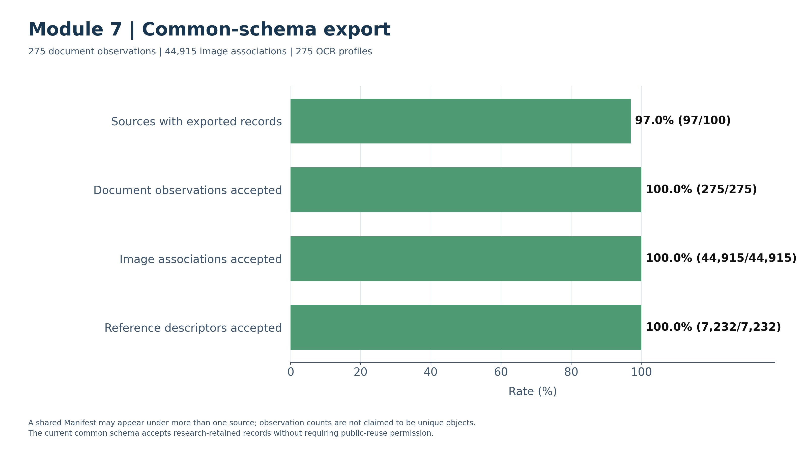<figcaption>Upper-left | Figure 07: common-schema export.</figcaption></figure>
<figure>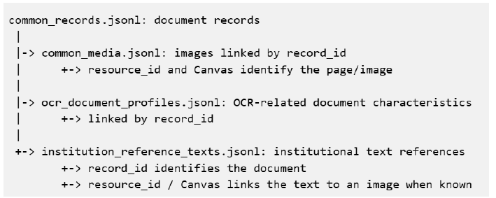<figcaption>Lower-right | Document-image-reference structure.</figcaption></figure>
</div>

**Figure notes.** The first bar measures source coverage, 97/100. The other bars are conditional schema acceptance: 275/275 document records, 44,915/44,915 image associations and 7,232/7,232 reference descriptors. M7 also exports 275 OCR profiles. Schema acceptance checks structure and required relationships; it does not certify historical metadata or transcription accuracy.

**How the linkage works.**

| Output | Meaning and join |
|---|---|
| common_records.jsonl | Document descriptions, provenance and rights; indexed by record_id. |
| common_media.jsonl | Image URLs and Canvas information; record_id identifies the parent document and resource_id identifies the image resource. |
| ocr_document_profiles.jsonl | OCR-related document characteristics and their evidence; joined by record_id. |
| institution_reference_texts.jsonl | Institutional text declarations; resource_id and Canvas link them to a page when known. Document-level references remain document-level. |

**Reference coverage.** In the 100-source sample, 9 sources and 19 document observations supplied text declarations; 5,783 image records have declared page-level references. There are 7,232 descriptors because a page can have multiple reference resources. These numbers describe exported declarations, not downloaded or manually corrected texts.

**Spoken.** Module 7 validates the common output schema and preserves document, image and reference relationships. A shared document identifier connects the main record, images and OCR profile. When a reference belongs to a particular page, its resource identifier and Canvas connect it to the correct image. This gives Arsha a structured handoff for OCR testing. Module 8 then downloads selected images with three accompanying JSON files and retrieves linked reference text where available. The 100-source evaluation measured the exported records; the next slide demonstrates actual downloads separately.

**Module 8 output categories.**

```text
with_reference     : image plus at least one retrieved page-linked text
without_reference  : image with no declared page-linked text
reference_failed   : declared text exists but could not be retrieved
```

**Scope reminder.** [Figure 08](中期汇报/Fig/08_Module8_Not_Run.png), available in the figure folder but not shown in the deck, marks M8 as not run in the 100-source experiment. The separate two-image demonstration must not be used to claim that all 44,915 associations were downloaded.

<div class="pagebreak"></div>

# Demonstration and next steps

**Guide page 5 of 8 | Deck slides 9-11**

## Slide 9 | One batch through Modules 1-8

**Central video.** The console is on the left and output folders are on the right. During playback, show the completed stages, then the with_reference image and text, followed by the without_reference image and its JSON files. The stills below identify the two outputs; video positions change during playback.

<div class="figure-strip photo-strip">
<figure>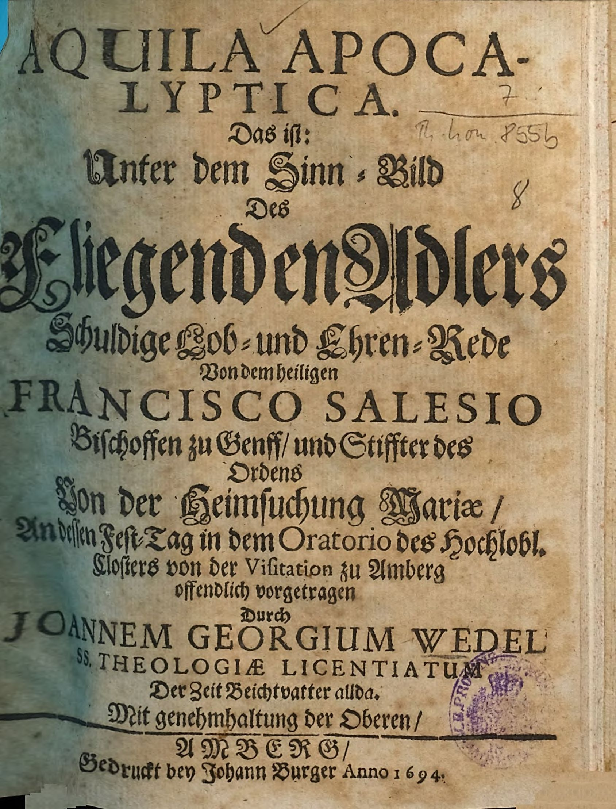<figcaption>with_reference | BSB, 1694 German print.</figcaption></figure>
<figure>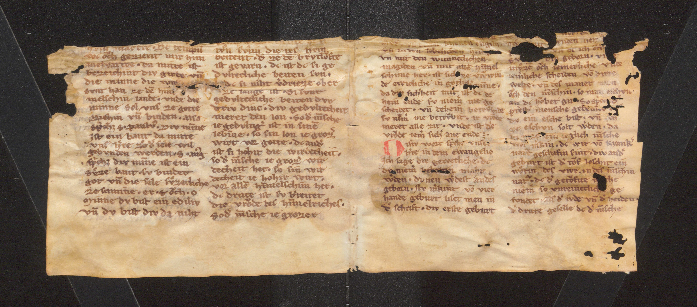<figcaption>without_reference | Fragmentarium, dated 1275-1325.</figcaption></figure>
</div>

**Spoken.** Here, two known Manifest URLs enter the same batch, and each module runs once. The BSB print supplies institutional hOCR; the medieval manuscript has no declared page-linked reference text. M7 exports two document records and 37 image associations. M8 downloads one image from each available reference category, giving two images, six base JSON files and one retrieved hOCR with extracted text. The saved run reports zero image or reference failures. These known inputs demonstrate module handoff and download classification, not discovery from an unfamiliar homepage.

**Recorded evidence:** existing run 20261106_163810_996681; one pipeline log lists M1-8 once, all with exit code zero; 34 exported reference descriptors, of which one text resource was actually downloaded. No cached images were used. Do not mix this with the earlier two-separate-run demonstration.

**Native command, from E:\exchange-epfl\Semester_Project:**

```powershell
.\pipeline.cmd --modules 1-8 --manifest-url "https://api.digitale-sammlungen.de/iiif/presentation/v2/bsb12188327/manifest" --manifest-url "https://fragmentarium.ms/metadata/iiif/F-u3vo/manifest.json" --max-manifests 1 --download example --example-per-category --force-refresh --no-llm
```

## Slide 10 | LLM discovery and visual interface

**Left panel:** investigate unresolved sources, propose and validate discovery recipes, store successful configuration and evidence, then evaluate on unseen sources. The optional API interface is implemented; real-model discovery performance remains unmeasured. Saved recipes do not retrain the model.

**Right panel:** a planned visual interface for selecting sources and modules, configuring downloads, monitoring errors and browsing linked outputs. The unified command-line launcher already exists.

**Spoken.** My next priority is to reduce the work needed to add a new source. An optional LLM can propose a discovery recipe, but actual HTTP and IIIF checks must validate the result before the recipe is reused. I still need to evaluate real-model success, cost and reuse on unseen sources. A visual interface is the second direction: it would make configuration, progress monitoring and result inspection easier for other researchers.

## Slide 11 | Thanks

**Spoken.** Thank you. I would welcome feedback on discovery generalization and the most useful output format for downstream OCR evaluation.

<div class="pagebreak"></div>

# Optional figure illustrations I

**Guide page 6 of 8 | Deck slide 12 | Backup material**

Read the panels clockwise: **upper-left -> upper-right -> lower-right -> lower-left**. Use only the panels relevant to a question.

<div class="quadrants">
<figure class="upper-left"><h3>Upper-left | Figure 09: cohort and scope</h3>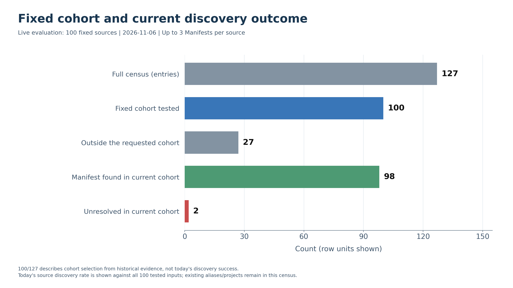<figcaption>The census contains 127 entries. The fixed test set contains 100 historically validated entries; 27 were outside this test. Of the tested 100, 98 yielded Manifest URLs and two remained unresolved. The 27 untested entries are not an additional 27 failures in this experiment. Source entries include institutional projects and aggregators.</figcaption></figure>
<figure class="upper-right"><h3>Upper-right | Figure 10: response types</h3>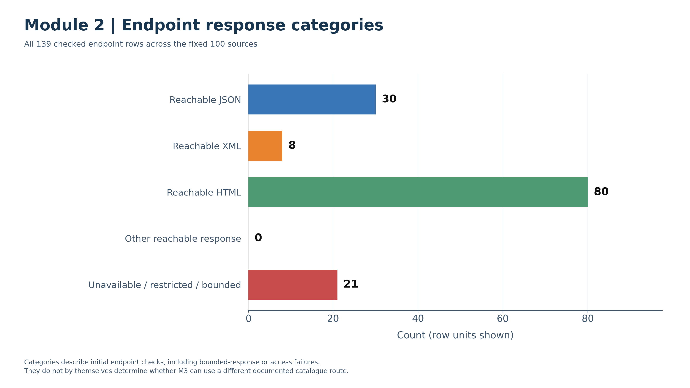<figcaption>Among 139 endpoints, 30 returned parseable JSON, 8 XML and 80 HTML; 21 checks were unsuccessful. The unit is endpoints, not sources. Thirty JSON endpoints belong to 29 sources. XML and HTML require different discovery strategies and may still lead to valid Manifests.</figcaption></figure>
<figure class="lower-right"><h3>Lower-right | Figure 13: references</h3>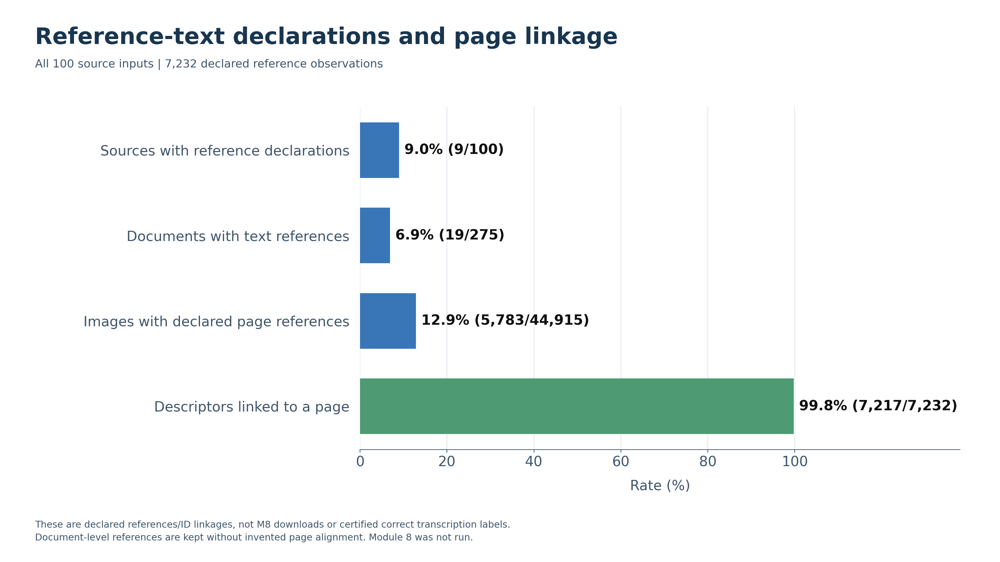<figcaption>References occur in 9/100 sources, 19/275 document observations and 5,783/44,915 image records (12.9%). Of 7,232 reference descriptors, 7,217 have a page link (99.8%); the other 15 remain document-level. These bars have different denominators. Linkage is not transcription accuracy, and declarations are not downloaded texts.</figcaption></figure>
<figure class="lower-left"><h3>Lower-left | Figure 11: rights evidence</h3>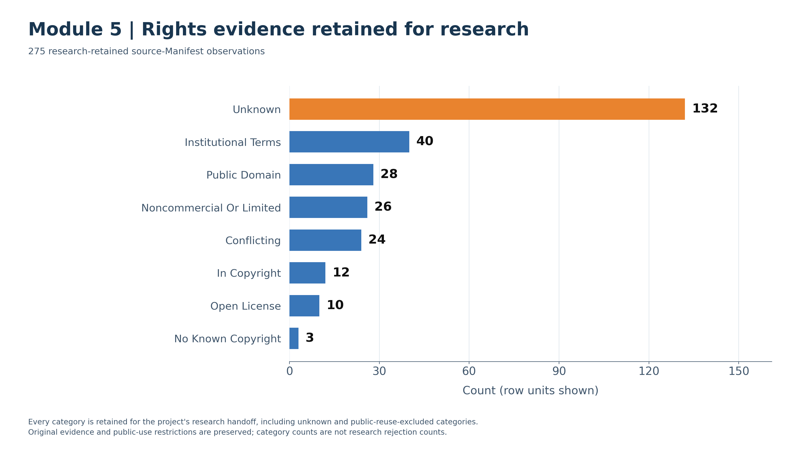<figcaption>The 275 records comprise unknown (132), institutional terms (40), public domain (28), noncommercial/limited (26), conflicting (24), in copyright (12), open licence (10), and no known copyright (3). All remain in the project research handoff. Original evidence and public-use restrictions stay attached; unknown does not mean copyright-free.</figcaption></figure>
</div>

**Optional spoken explanation.** These figures separate four questions: which sources were selected, what their supplied endpoints returned, which sampled images have reference declarations, and what rights evidence accompanies the records. They show why accessibility, research retention and OCR-reference availability require different metrics. They do not establish full institutional coverage, unrestricted public reuse or correct transcriptions.

<div class="pagebreak"></div>

# Optional figure illustrations II

**Guide page 7 of 8 | Deck slide 13 | Backup material**

<div class="figure-strip optional-two">
<figure><h3>Upper-left | Figure 14: field availability</h3>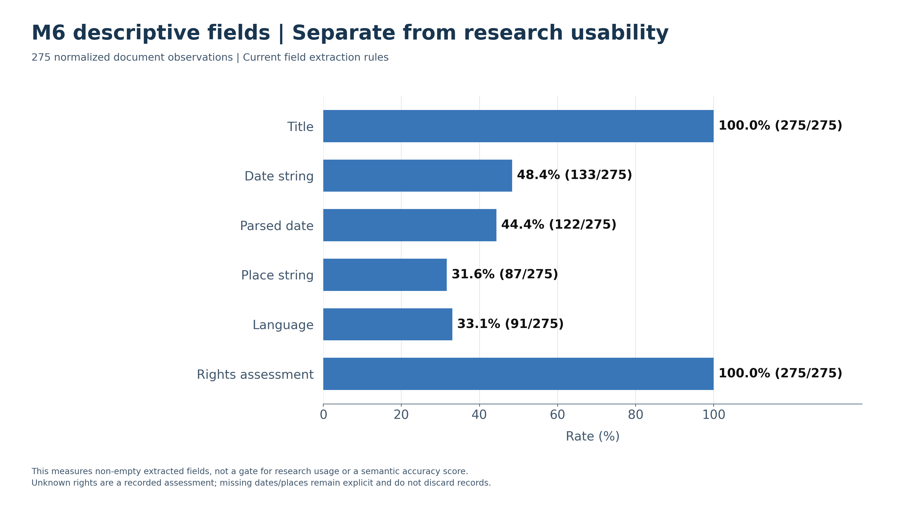<figcaption>Out of 275 records, titles and rights assessments are present in all 275; date strings in 133 (48.4%), parsed dates in 122 (44.4%), places in 87 (31.6%) and languages in 91 (33.1%). The gap between raw and parsed dates concerns normalization. A low field count can reflect absent metadata or extraction limitations. It is not a research rejection rate or an accuracy score.</figcaption></figure>
<figure><h3>Upper-right | Figure 12: image yield</h3>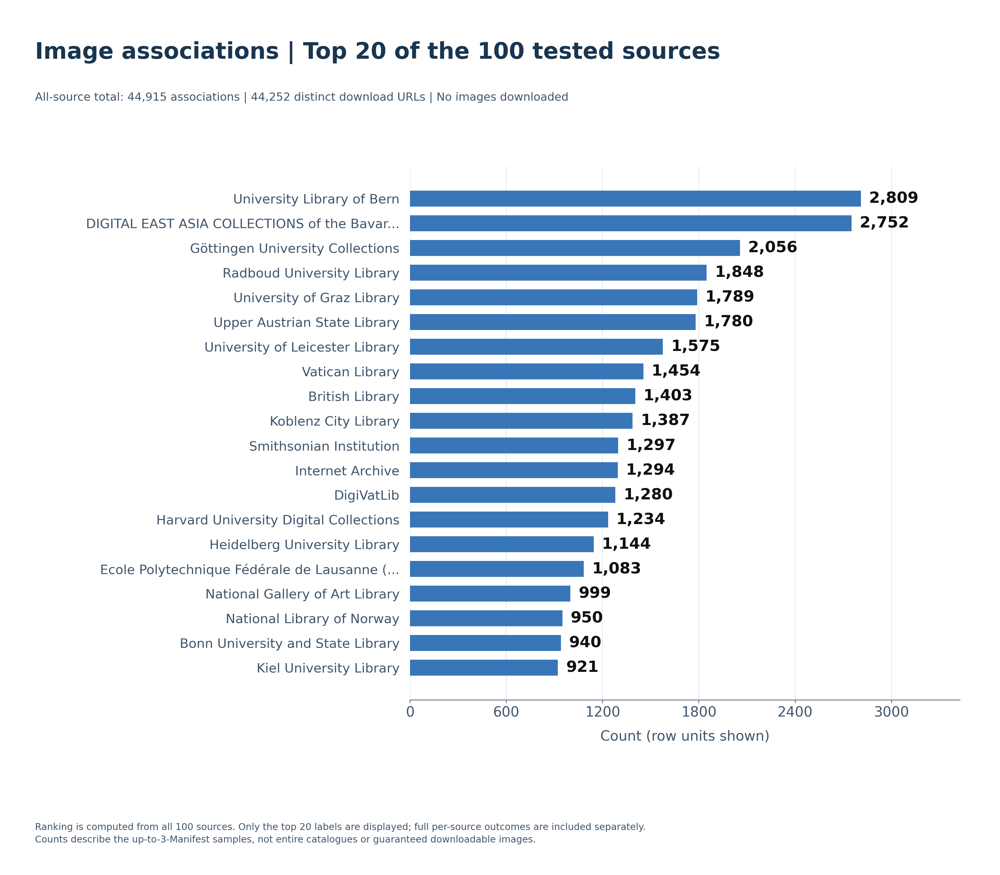<figcaption>The ranking shows the top 20 of all 100 tested sources. Bern contributes 2,809 sampled image associations and the BSB East Asia entry 2,752. Long documents can yield many pages from few Manifests. The all-source total is 44,915 associations and 44,252 distinct download URLs; neither is an actual download count. The ranking does not compare entire collection sizes.</figcaption></figure>
</div>

**Optional spoken explanation.** Descriptive metadata remains uneven, especially dates, places and languages, so missing values must stay explicit. The image-yield chart shows what the bounded Manifest sample contributes. It should guide further sampling rather than be extrapolated into a claim about the full holdings of these institutions.

## Additional backup assets | Figure 15, five panels

These five PNGs are available in the figure folder, but are not additional slides in the supplied deck. Together they cover all 100 sources, 20 per panel.

<div class="panel-strip">
<figure>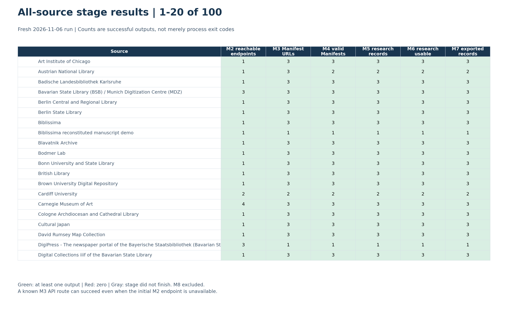<figcaption>Sources 1-20</figcaption></figure>
<figure>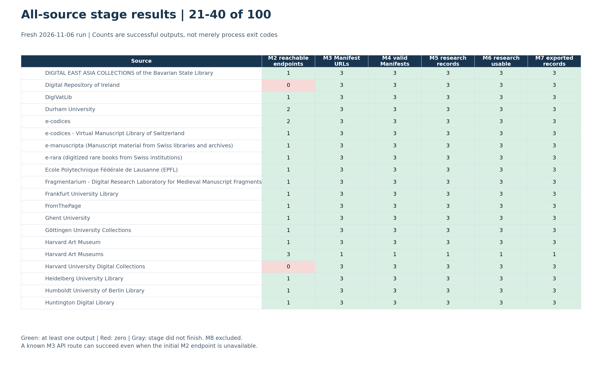<figcaption>Sources 21-40</figcaption></figure>
<figure>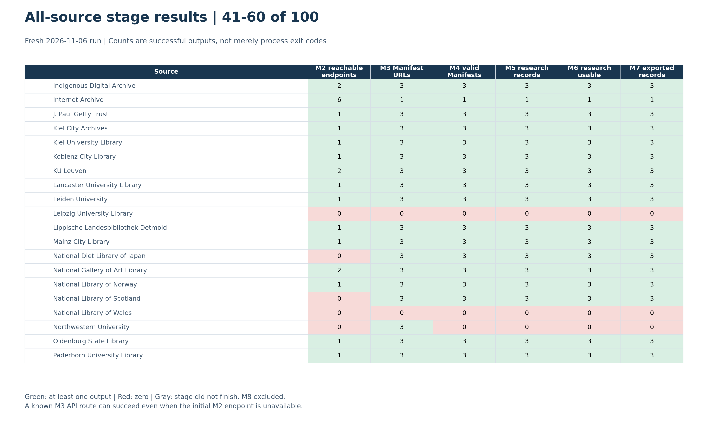<figcaption>Sources 41-60</figcaption></figure>
<figure>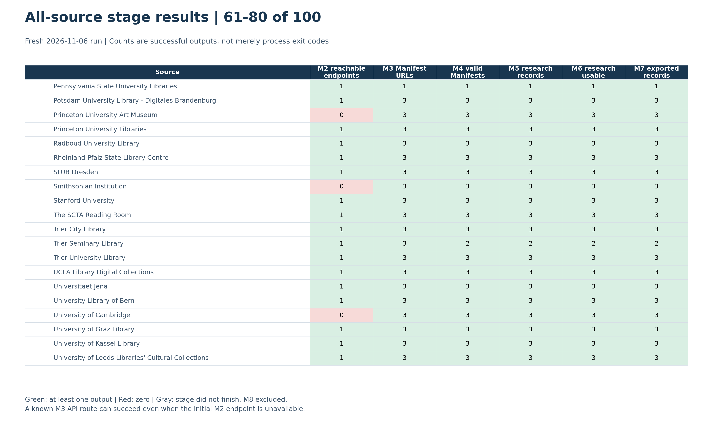<figcaption>Sources 61-80</figcaption></figure>
<figure>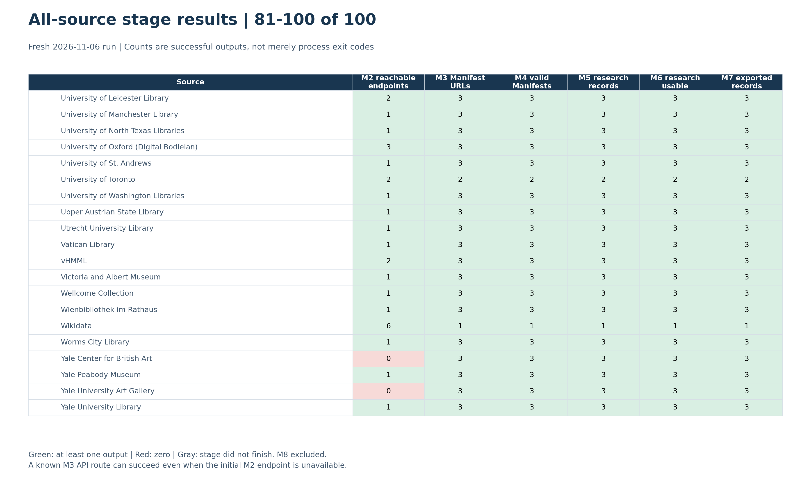<figcaption>Sources 81-100</figcaption></figure>
</div>

**How to read the tables.** M2 counts reachable endpoints; M3 counts discovered Manifest URLs; M4 counts accepted image Manifests; M5 counts research-retained records; M6 counts research-usable normalized records; M7 counts exported records. Green means at least one output, red means zero, and gray means the stage did not finish. These are output counts, not merely successful process exits. A saved M3 API route can succeed even when all supplied M2 entries fail.

**Examples for questions.** Leipzig and Wales have no M3 output in this run. Northwestern has three M3 URLs but no M4 image output. These are specific current-run observations, not proof that those institutions lack IIIF or images. The original PNG tables are intended for zoomed inspection; the small previews here identify the panels.

<div class="pagebreak"></div>

# Possible supervisor questions and answers

**Guide page 8 of 8 | Discussion material**

**1. Why only 100 sources?** The census contains 127 entries; this run retested the 100 with historical success evidence. It is a fixed evaluation cohort, not an exhaustive list of IIIF institutions or 100 deduplicated institutions.

**2. Why at most three Manifests per source?** The cap keeps the live test manageable while checking the module handoff across all selected sources. It does not measure complete catalogue enumeration or guarantee representative document diversity.

**3. Why is M3 at 98% when M2 is at 88%?** M2 checks the supplied entry points. M3 can use saved alternative catalogue/API routes, so discovery can succeed despite a failed homepage check.

**4. Why do 275 records correspond to 269 Manifests?** Records are source-specific observations; a Manifest URL can occur under more than one source. Likewise, 44,915 image associations contain 44,252 distinct download URLs, not 44,915 proven unique image files.

**5. Why did previously successful sources fail?** Current requests can encounter access restrictions, timeouts or client errors. Northwestern also exposed a sampling limitation: its first three results had no image bodies. Previous success and present-run failure answer different questions.

**6. What does 100% research retention mean?** All 275 accepted incoming records were retained under the project policy, including unknown/restricted categories. It does not mean every source succeeded or that all records allow public/commercial reuse. Technical accessibility alone is not a licence.

**7. Are institutional texts ground truth?** They are reference candidates linked to images, not automatically verified correct transcriptions. Human correction status and OCR accuracy need assessment before using them as trusted evaluation labels.

**8. Do you know the languages, scripts and scan quality?** Language metadata was extracted for 91/275 records. Page-level scripts, typefaces and scan defects still require representative inspection or annotation; missing evidence remains unknown.

**9. Does Omeka S replace IIIF?** No. For Plume, its catalogue API enumerates item identifiers; the resulting resources use standard IIIF Presentation and Image services. Item pages also expose IIIF links. The API route improves discovery efficiency.

**10. How generic is the approach?** Reusable traversal and extraction operations are separated from provider configuration. Known-source coverage is demonstrated; unseen-source generalization needs a held-out evaluation. New behaviour outside the existing operations may still require code changes.

**11. What does AI do, and what does it remember?** AI can assist investigation and propose data-only recipes. Actual HTTP/JSON/IIIF checks gate acceptance. Saved recipes preserve configuration and evidence, not retrained model weights. Real-model autonomous discovery performance has not yet been measured.

**12. What does the Demo prove?** One batch ran M1-8 once for two known Manifests, exporting 37 image records and downloading two images plus one institutional hOCR. It demonstrates linked delivery and output categories; the 100-source experiment remains a separate M1-7 evaluation.

<div class="sources">
<strong>Evidence:</strong> <a href="中期汇报/Mid-term.pdf">13-slide deck</a>; <a href="../../../Code_git/Pipeline_Runner/verification/2026-11-06_100_sources.json">100-source counts</a>; <a href="../../../Code_git/Pipeline_Runner/verification/2026-11-06_single_batch_demo.json">existing single-batch Demo log</a>; <a href="../../../Code_git/Pipeline_Runner/verification/2026-11-05_cli_and_llm.json">LLM interface verification scope</a>. Figure labels and counts follow the supplied PNGs. This guide corrects copied overview labels and the ambiguous rights sentence without modifying the original deck.
</div>
