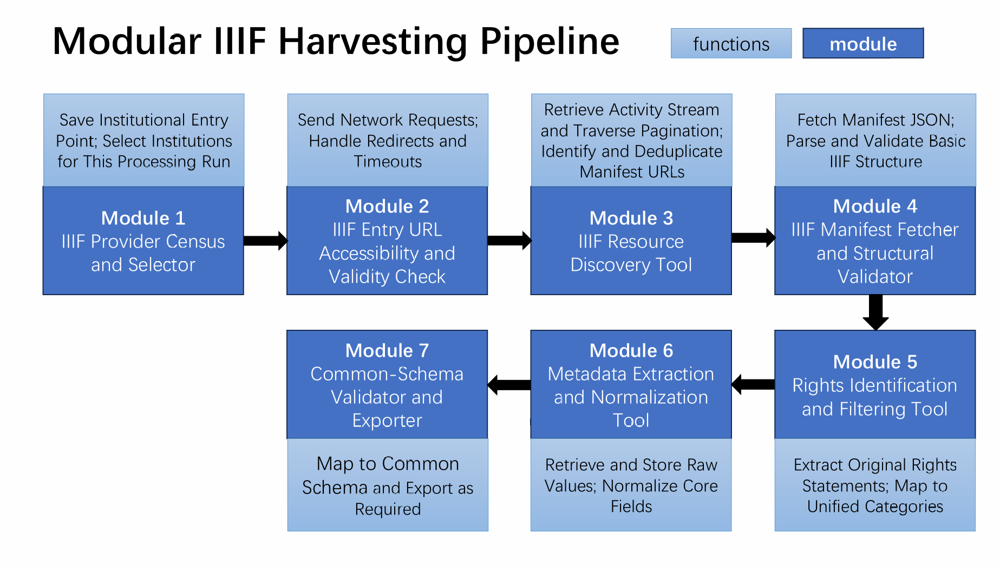

# 阅读说明

这份报告用于理解当前代码，而不是代替代码和正式 IIIF 规范。阅读时建议按下列顺序进行：

1. 先看第 2-4 章，理解项目目标、IIIF 概念和七个模块之间的关系。
2. 再看第 5 章，逐个理解每个模块的输入、内部处理和输出。
3. 看第 7-8 章，区分已经验证的结果、泛化实验和当前限制。
4. 最后看第 9-11 章，理解如何运行、Module 7 的临时输出以及可能被问到的问题。

报告中有三类结论：

- **任务要求**：来自教师项目说明和组内衔接关系。
- **已经实现并测试的内容**：可以由代码、测试和日志复现。
- **当前工程决定**：例如 Module 7 的 `provisional-0.1` 临时模式，之后可以根据教师或组员要求修改。

# 项目目标与当前结论

## 任务目标

本项目负责 IIIF 数据流水线的前半部分：建立提供者清单，找到机构公开的 IIIF 资源，取得 Manifest，按版权筛选，规范化元数据，并交付为组内公共结构。教师任务说明要求最终记录能够表达至少以下核心信息：

- `identifier`：对象或 Manifest 的稳定标识符；
- `date`：日期原文和可用的规范化时间；
- `place`：地点原文和可用的规范化地点；
- `rights`：版权或许可状态；
- `source`：机构、Manifest 地址和发现来源。

这些结果一方面交给同组同学继续读取图片和进行 OCR，另一方面应当能够进入组内公共模式，并最终服务于 Time Atlas。OCR、版面分析、实体抽取和 Time Atlas 前端不属于本流水线当前的主要任务。

## 当前完成状态

截至 2026 年 9 月 27 日：

- Module 1-7 的初代确定性流水线已经全部实现；
- 已增加一个统一运行器，可以顺序执行全部模块，也可以从中间模块恢复；
- 8 个组件共有 **108 项自动化测试，全部通过**；
- 已完成一次受限的真实 Module 1-7 联调；
- 真实联调最终得到 **2 条对象记录和 54 条媒体记录，0 条拒绝记录**；
- Module 7 已执行 JSON Schema 和额外语义校验，并为全部交付文件生成 SHA-256；
- 当前最大技术瓶颈仍然是 Module 3 对不同机构发现方式的泛化能力；
- Module 7 目前使用临时公共模式，周二获得最终字段要求后只修改 Module 7 即可。

## 一句话解释整条流水线

先整理“有哪些仓库及其所有入口”，再逐一测试入口是否可访问，然后针对不同入口类型寻找货物清单；取得清单后验证结构、筛选版权、整理元数据，最后包装成统一且可校验的数据产品。

# 必须掌握的 IIIF 概念

## Provider、Endpoint 与 Manifest

**Provider** 是提供数字文化遗产资源的机构或项目。一个 Provider 可能有多个 **Endpoint**，例如机构主页、IIIF Collection、Change Discovery 流、单个 Manifest、搜索 API 或记录页面。

**Manifest** 是 IIIF Presentation API 中对一个数字对象的描述。它可以描述一本书、一份手稿、一件艺术品或一个多页对象，但不能简单等同于“展品”或“古物”。Manifest 通常包含：

- 对象标识符和标题；
- 描述性元数据；
- Canvas 顺序；
- 图片或其他内容资源；
- Image API 服务地址；
- 版权或许可声明。

## Presentation API 与 Image API

**Presentation API** 负责描述一个数字对象如何组织，因此 Manifest 和 Collection 属于 Presentation API。

**Image API** 负责图片的尺寸、裁剪、旋转、质量和格式。`info.json` 描述的是图片服务，并不自动等于 Manifest。发现一个 Image API 服务只能证明图片可以通过 IIIF 传输，不能证明机构同时公开了完整的 Presentation Manifest。

## Collection 与 Change Discovery

**IIIF Collection** 是 Manifest 或子 Collection 的集合。大型机构经常通过 `items`、`manifests`、`members` 和 `next` 分页公开资源。

**Change Discovery API** 使用 Activity Streams 表达资源的新增、更新、移动或删除。入口通常是 `OrderedCollection`，分页对象是 `OrderedCollectionPage`。发现程序必须处理分页、资源类型、活动类型和去重。

## 为什么不能只访问清单中的第一个链接

官方指南和社区目录的链接并不都是统一的批量接口。它们可能指向：

- 人类阅读的机构主页；
- 单个对象页面；
- 单个 Manifest；
- IIIF Collection；
- Change Discovery；
- 机构 REST API；
- Image API 示例；
- 软件或 IIIF 查看器。

因此，Module 1 必须保留每个机构的全部候选入口；Module 2 必须检查全部入口；Module 3 才负责识别入口类型并采用相应发现策略。

# 总体架构与数据流

{width=96%}

七个模块的责任边界如下。

| 模块 | 核心责任 | 不负责的工作 |
|---|---|---|
| Module 1 | 建立机构及全部候选入口清单，选择本次机构 | 不证明入口可访问，不抓取 Manifest |
| Module 2 | 检查每个入口的网络和响应状态 | 不遍历 Collection 或发现全部资源 |
| Module 3 | 解析不同入口并发现 Manifest URL | 不完整下载和验证每个 Manifest |
| Module 4 | 下载、缓存并验证 Manifest 结构 | 不作版权决策，不规范化描述元数据 |
| Module 5 | 提取版权证据并自动 allow/exclude | 不把缺失版权当作公共领域 |
| Module 6 | 保留原始值并规范化核心元数据 | 不猜测缺失值，不做地理编码 |
| Module 7 | 映射、校验并导出公共数据包 | 不改变上游抓取和版权判断 |

核心交接文件依次为：

```text
selected_providers.jsonl
  -> checked_entry_points.jsonl
  -> manifest_urls.jsonl
  -> validated_manifests.jsonl + manifest_resource_inventory.jsonl
  -> allowed_manifests.jsonl + allowed_resource_inventory.jsonl
  -> normalized_records.jsonl + normalized_resources.jsonl
  -> common_records.jsonl + common_media.jsonl + dataset_manifest.json
```

JSONL 是主要机器交换格式。它每行保存一个完整 JSON 对象，适合流式读取、追加、失败恢复和保留嵌套来源信息。CSV 主要用于人工查看和表格软件，不作为无损主格式。

# 各模块的实现

## Module 1：Provider Census and Selection

### 输入

Module 1 合并四类来源：

1. IIIF Registry；
2. IIIF 官方资源指南的本地快照；
3. 社区维护的 Awesome IIIF Catalogue 快照；
4. 项目自行维护的机构条目。

Registry 是自愿登记系统，因此 Registry 条目数量不能代表所有使用 IIIF 的机构。官方指南和社区目录覆盖更广，但其中很多地址只是候选入口。

### 内部处理

- 将来源条目转换成统一 Provider 结构；
- 保留原始来源、来源页面和全部候选链接；
- 规范化 URL；
- 根据稳定 Provider ID、机构 URL 或已经共享的入口合并记录；
- 不因为名称相同就直接合并两个机构；
- 每个机构使用一个 `provider_id`，全部入口保存在动态 `endpoints[]` 数组；
- 根据命令行的机构名称或 `all` 选择本次运行范围。

### 输出

- `providers.jsonl`：完整机构清单；
- `selected_providers.jsonl`：本次选择，交给 Module 2；
- `providers.csv`：每个入口一行的查看表；
- `Module1_时间_log.txt`：来源、数量、选择和路径。

当前正式清单结果为 **94 个 Provider、158 个候选 Endpoint**。一个 Provider 可以拥有任意数量的入口，`endpoint_role` 也不是固定数量。

## Module 2：Entry URL Accessibility and Validity Check

### 输入

读取 Module 1 的 `selected_providers.jsonl`，遍历每个 Provider 的全部 `endpoints[]`。

### 内部处理

每个入口都会执行：

- HTTP GET；
- 超时和有限重试；
- 重定向跟随；
- HTTP 状态码记录；
- 最终 URL 和响应耗时记录；
- Content-Type 记录；
- JSON 解析尝试；
- 响应大小限制；
- 错误分类。

典型结果包括 `reachable_json`、`reachable_non_json`、`invalid_json`、`restricted`、`temporary_failure`、`unreachable` 和 `response_too_large`。

### 输出

主要文件是 `checked_entry_points.jsonl`。每一行代表一个 Provider-Endpoint 组合，同时保留原 Provider、候选入口和检查结果。

需要特别注意：`reachable_non_json` 不是“没有 IIIF”。一个 HTML 页面仍可能包含 Manifest 链接、JSON-LD、查看器配置或通往对象页的链接。这些由 Module 3 继续处理。

## Module 3：IIIF Resource Discovery

Module 3 是当前流水线中对泛化能力影响最大的模块。

### 输入

- Module 2 的全部已检查入口；
- 可选的、带来源依据的机构入口配置；
- 统一的请求、分页、深度和 Manifest 数量限制。

### 已实现策略

1. **Change Discovery**：解析 `OrderedCollection` 和 `OrderedCollectionPage`，处理 `last`、`prev`、活动类型和资源引用。
2. **Presentation Collection**：读取 Presentation 2/3 Collection，遍历子 Collection，并支持 `next` 分页。
3. **Direct Manifest**：入口本身是 Manifest 时直接接受。
4. **HTML discovery**：读取显式 Manifest 链接、IIIF data attribute、JSON-LD 和有限的同站点相关页面。
5. **Generic JSON API adapter**：在 JSON API 中跟随键名或值明确指向 Manifest、Collection 或 IIIF 的 URL。
6. **Curated entry point**：使用有文档依据的入口，但仍需重新请求和类型验证。

### 输出

- `provider_discovery.jsonl`：每个 Provider 的完整审计过程；
- `resolved_endpoints.jsonl`：已确认的机器接口；
- `manifest_urls.jsonl`：去重后的 Manifest URL，交给 Module 4；
- `unresolved_providers.jsonl`：在当前策略和限制内未发现 Manifest 的机构；
- 日志和 CSV 汇总。

### 当前含义

Module 3 成功表示“至少一条路线在给定限制内找到 Manifest”。失败只表示“当前路线和限制没有找到”，不能推断机构没有 IIIF。

## Module 4：Manifest Fetcher and Structural Validator

### 输入

Module 3 的 `manifest_urls.jsonl`，每条记录包含稳定 `manifest_id`、Manifest URL、Provider 和发现证据。

### 内部处理

- 优先使用本地缓存；
- 必要时请求 Manifest；
- 保存服务器返回的可解析 JSON 原始字节；
- 记录请求元数据和 SHA-256；
- 检查资源类型是否为 Manifest；
- 支持 Presentation 2 的 `sequences/canvases`；
- 支持 Presentation 3 的 `items/Canvas`；
- 提取 Canvas、内容 Body、图片格式、Image Service、辅助文件和顶层版权值；
- 区分 `valid`、`manual_review`、`invalid` 和 `unavailable`。

### 输出

- `validated_manifests.jsonl`；
- `manifest_resource_inventory.jsonl/csv`；
- `manual_review.jsonl`；
- `invalid_manifests.jsonl`；
- `unavailable_manifests.jsonl`；
- 原始 Manifest 缓存、请求元数据和日志。

Module 4 的人工检查分类表示 Manifest 结构可能不完整或不典型。它与 Module 5 的版权决策不同；Module 5 已按照要求取消版权人工队列。

## Module 5：Rights Identification and Filtering

### 自动版权原则

Module 5 是全自动阶段，只输出 `allow` 或 `exclude`。

- 明确 Public Domain、CC0、CC BY、CC BY-SA：允许；
- 非商业或其他限制、仍在版权期、No Known Copyright、机构条款、未知或冲突：排除；
- 没写版权时分类为 `unknown`，不能自动理解为公共领域；
- 原始 JSON 丢失、不可解析或 SHA-256 不一致时自动排除。

这里的“排除”指不进入本次版权清洁数据集，不表示对象不存在，也不等于法律上的永久禁止使用。

### 内部处理

- 校验 Module 4 原始文件 SHA-256；
- 从 Manifest、Canvas、Annotation、Body、rights-labelled metadata、`requiredStatement` 和旧版 `attribution` 提取证据；
- 保存原始值、规范值、JSON 路径、资源层级和匹配规则；
- 区分决定性版权证据和仅提供署名的文本；
- 使用带版本号的自动政策进行分类和决策。

### 输出

- `rights_assessed_manifests.jsonl`：全部评估记录；
- `allowed_manifests.jsonl`；
- `excluded_manifests.jsonl`；
- `allowed_resource_inventory.jsonl/csv`；
- `rights_summary.csv` 和日志。

## Module 6：Metadata Extraction and Normalization

### 输入

只读取 Module 5 明确放行的 Manifest 和媒体资源，并再次验证 Module 4 原始 Manifest 的 SHA-256。

### 规范化字段

- identifier；
- title 与 description；
- creators；
- dates；
- places；
- subjects；
- types；
- languages；
- rights；
- source。

日期只在能够识别 ISO 日期、年份、年份区间或世纪时进行规范化。例如 `1401-1500 CE` 转换为起始年 1401、结束年 1500、精度 `year_range`。无法解析时保留原文，规范值为 `null`。

地点目前只清理文本和识别 `unknown` 等缺失表达，不进行坐标查询。地理编码属于后续扩展或其他组员的任务。

### 输出

- `normalized_records.jsonl`：每个 Manifest 一条对象记录；
- `normalized_resources.jsonl`：每个 Canvas/图片一条媒体记录；
- `metadata_summary.csv`；
- `normalized_resources.csv`；
- `failed_records.jsonl` 和日志。

如果核心字段缺失，记录不会被静默删除，而是标记为 `partial` 并列出 `missing_fields` 和 `warnings`。

## Module 7：Common-Schema Validator and Exporter

Module 7 是可替换的最后映射层。当前组内最终公共模式尚未正式提供，因此使用 `provisional-0.1` 临时模式。

### 内部处理

- 把 Module 6 对象映射到公共对象记录；
- 把媒体资源映射到公共媒体记录；
- 使用 Draft 2020-12 JSON Schema 验证；
- 额外检查 HTTP(S) URL、版权放行状态、日期范围、ID 唯一性和外键；
- 拒绝重复对象、重复媒体或找不到父对象的媒体；
- 为全部交付文件计算 SHA-256。

### 输出

- `common_records.jsonl/csv`；
- `common_media.jsonl/csv`；
- `rejected_records.jsonl`；
- `rejected_media.jsonl`；
- `dataset_manifest.json`；
- Module 7 日志。

周二如果收到不同字段要求，主要修改 Module 7 的 profile、mapper、JSON Schema、CSV 展开和相应测试。Module 1-6 的采集、版权和规范化逻辑无需重写。

# Module 7 当前输出结构

## 对象记录 `common_records`

每个 Manifest 对应一条对象记录，核心结构如下：

```json
{
  "schema_version": "iiif-time-atlas-record-0.1",
  "record_id": "manifest-...",
  "object": {
    "identifier": "https://.../manifest.json",
    "identifiers": [],
    "title": "Preferred title",
    "titles": [],
    "description": null,
    "descriptions": [],
    "creators": [],
    "dates": [
      {
        "raw": "1401-1500 CE",
        "normalized": "1401/1500",
        "start_year": 1401,
        "end_year": 1500,
        "precision": "year_range",
        "approximate": false,
        "source_label": "Date of origin"
      }
    ],
    "places": [
      {"raw": "Tübingen", "normalized": "Tübingen"}
    ],
    "subjects": [],
    "types": [],
    "languages": []
  },
  "rights": {
    "category": "open_license",
    "decision": "allow",
    "policy_version": "automatic-2026-09-25",
    "statements": []
  },
  "source": {
    "manifest_id": "manifest-...",
    "manifest_url": "https://.../manifest.json",
    "presentation_version": "2",
    "providers": [],
    "discovery_evidence": []
  },
  "media_count": 3,
  "quality": {},
  "provenance": {}
}
```

其中 `record_id` 是媒体表的外键目标。`quality` 记录完整或部分状态，`provenance` 记录各模块版本和处理时间。

## 媒体记录 `common_media`

每个 Canvas/图片对应一条媒体记录：

```json
{
  "schema_version": "iiif-time-atlas-media-0.1",
  "resource_id": "resource-...",
  "record_id": "manifest-...",
  "sequence": 0,
  "canvas": {"id": "https://.../canvas/1", "label": "1r"},
  "image": {
    "id": "https://.../full/full/0/default.jpg",
    "type": "Image",
    "format": "image/jpeg",
    "service_urls": ["https://.../iiif/image-id"]
  },
  "rights": {
    "category": "open_license",
    "decision": "allow",
    "policy_version": "automatic-2026-09-25"
  },
  "source_manifest_url": "https://.../manifest.json"
}
```

同组 OCR 程序可以从 `image.id` 读取现成图片，或根据 `image.service_urls` 使用 IIIF Image API 选择尺寸。通过 `record_id` 可以把 OCR 结果重新连接到对象元数据。

## `dataset_manifest.json`

数据包清单记录：

- bundle、profile、record schema 和 media schema 版本；
- 输入、有效和拒绝的对象及媒体数量；
- 每个导出文件的文件名、字节数和 SHA-256；
- Module 6 输入路径和当前 Schema 路径；
- 数据包生成时间。

它用于确认交付是否完整、文件是否被修改以及接收方是否使用了正确模式版本。

# 实验与测试结果

## 自动化测试

| 组件 | 测试数 |
|---|---:|
| Module 1 | 14 |
| Module 2 | 12 |
| Module 3 | 19 |
| Module 4 | 15 |
| Module 5 | 14 |
| Module 6 | 14 |
| Module 7 | 14 |
| Pipeline Runner | 6 |
| **总计** | **108** |

全部测试通过。Module 2-4 的网络测试使用本地确定性 HTTP 服务器，不依赖外部机构当时是否在线。

## Module 3 泛化实验

94 个机构按机构域名分组，划分为 75 个开发机构和 19 个独立测试机构。测试机构没有在划分后增加机构专用代码。

| 指标 | 开发集 | 独立测试集 |
|---|---:|---:|
| Provider 数 | 75 | 19 |
| Endpoint 数 | 121 | 37 |
| 至少一个入口可访问 | 53 | 16 |
| 至少一个 JSON 入口 | 5 | 1 |
| 找到 Manifest 的机构 | 9 | 2 |
| 机构成功率 | 12.0% | 10.5% |
| Manifest URL 数 | 306 | 19 |

{width=93%}

独立测试成功的机构是 Digital Commonwealth 和 Fragmentarium。17 个未解决机构中：3 个没有可访问入口，4 个入口可访问但有限爬取未发现 IIIF 候选，10 个尝试了候选路线但未确认 Manifest。

这个结果说明当前通用策略可以迁移到直接 Manifest 和 HTML 显式链接，但对机构 API、搜索接口、标识符枚举和 Manifest URL 模板的支持仍不足。

{width=88%}

## Manifest 和图片容量调查

对开发集和独立测试集发现的 325 个 Manifest URL 进行媒体盘点时：

- 324 个返回有效 Manifest，1 个发生网络超时；
- 声明 52,606 个 Canvas；
- 声明 52,618 个图片 Body；
- 声明 52,619 个 Image Service；
- 120 个 Manifest 有顶层版权或许可，204 个没有。

这些是 Manifest 中声明的图片资源，不表示图片文件已经全部下载，也不表示全部通过版权策略。它们足以支持小规模 OCR 技术联调，但提供者多样性和版权可用比例仍需改进。

## 真实 Module 1-7 受限联调

可复现命令使用 `pipeline.fragmentarium-smoke.json`，限制最多发现两个 Manifest，防止意外启动大规模抓取。

结果如下：

1. Module 1 重建 94 个 Provider、158 个 Endpoint，并选择 Fragmentarium。
2. Module 2 检查 1 个入口；它是可访问的 HTML，而不是 JSON。
3. Module 3 从该 HTML 路线发现 2 个 Manifest。
4. Module 4 验证 2 个 Manifest，得到 54 个 Canvas、53 个图片 Body 和 54 个 Image Service。
5. Module 5 放行 2 个 Manifest：1 个 open license、1 个 public domain，共 54 条媒体资源。
6. Module 6 得到 2 条完整规范化对象记录和 54 条媒体记录，0 个失败。
7. Module 7 得到 2 条有效对象记录和 54 条有效媒体记录，0 条拒绝。
8. 最终数据包的全部 SHA-256 已复核，没有不匹配。

这一结果证明了模块之间的数据契约确实连通。它是受限联调，不代表 Fragmentarium 的完整收获量，更不代表所有 IIIF 机构的总规模。

# 当前问题与下一步

## Module 3 泛化能力

当前最重要的改进方向是：

1. 建立带版本号的 Provider Adapter Registry；
2. 支持常见机构搜索 API 和分页；
3. 支持标识符枚举；
4. 支持可验证的 Manifest URL 模板；
5. 为大型 Collection 和 Change Discovery 增加更完善的 checkpoint 和恢复；
6. 继续使用独立机构测试集衡量新增策略是否真正泛化。

可选的大语言模型扩展应当放在确定性流水线之后。模型可以辅助阅读 API 文档或提出入口模板，但所有建议必须重新经过 HTTP 请求、IIIF 类型校验、有限遍历和回归测试，不能直接成为正式数据。

## Module 7 最终公共模式

需要从教师或组内负责人确认：

- 对象和媒体是否继续使用两张表；
- Time Atlas 所需日期、地点和坐标格式；
- OCR 文本应该挂在对象、Canvas 还是独立文本记录；
- 必填字段、允许空值和字段命名；
- 对外导出格式和版本策略。

在这些内容确认前，`provisional-0.1` 只表示工程上完整、可验证的临时交接模式，不能声称是教师最终批准的公共模式。

## 大规模运行

完整 `all` 运行可能涉及数千到数百万条资源，不能因为程序支持分页就直接无界运行。正式扩大规模前还需要确认：

- 首个完整抓取机构；
- 服务器资源和磁盘容量；
- 对方机构的速率限制和使用条款；
- 最大响应、并发、重试和等待策略；
- checkpoint、缓存和恢复策略；
- API key 的安全保存方式。

# 如何运行

## 安装和完整运行

```powershell
cd E:\exchange-epfl\Semester_Project\Code_git\Pipeline_Runner
python -m pip install -e .
python -m iiif_pipeline_runner --config pipeline.example.json
```

`pipeline.example.json` 默认选择全部机构，属于真实网络运行。运行前应检查各模块配置中的限制。

## 受限真实联调

```powershell
cd E:\exchange-epfl\Semester_Project\Code_git\Pipeline_Runner
python -m iiif_pipeline_runner --config pipeline.fragmentarium-smoke.json
```

这个配置只选择 Fragmentarium，并将发现限制为两个 Manifest，适合演示和端到端检查。

## 从中间模块继续

```powershell
python -m iiif_pipeline_runner `
  --config pipeline.example.json `
  --from-module 3 `
  --to-module 7
```

当上游输出已经存在，只修改了下游程序时，可以从中间继续。运行器在某个模块返回非零状态时立即停止，并保存命令、标准输出、错误输出和返回码。

## 单独运行模块

每个模块都可以进入自己的目录后运行：

```powershell
python -m <package_name> run --config config.example.json
```

包名依次为：

```text
iiif_provider_census
iiif_entry_validator
iiif_resource_discovery
iiif_manifest_validator
iiif_rights_filter
iiif_metadata_normalizer
iiif_common_exporter
```

# 明天可能问到的问题

## 为什么 Module 1 不能只用 IIIF Registry？

Registry 是自愿登记的 Change Discovery 清单，覆盖不完整。Module 1 因此组合 Registry、官方指南、社区目录和项目维护条目。候选清单不是已验证 API 清单。

## 为什么一个机构需要多个 Endpoint？

同一机构可能同时公开主页、Collection、Manifest、Change Discovery 和 REST API。只保留第一个链接会丢失最有价值的机器入口。

## Module 2 为什么不直接找到 Manifest？

Module 2 只提供统一的网络证据，避免把网络故障和发现逻辑混在一起。真正的分页、HTML 分析和类型解析属于 Module 3。

## HTML 入口是不是无效入口？

不是。Fragmentarium 的真实联调就是从可访问 HTML 入口找到 Manifest。HTML 只有在有限搜索没有发现任何 IIIF 证据时才是“当前未解决”。

## 为什么 Module 3 是泛化重点？

Module 1 的任务是列出机构和入口，Module 2 的任务是统一检查入口。机构之间真正不同的是资源发现方式，因此复杂度集中在 Module 3。

## Manifest 数量是不是对象数量？

Manifest 通常描述一个数字对象，但具体粒度由机构决定。它可能是一本书、一件艺术品、一个手稿片段或其他数字对象，所以报告中应使用“Manifest”而不是统一称为“展品”。

## Image Service 数量是不是已经下载的图片数量？

不是。它表示 Manifest 声明的图片服务引用。流水线当前保存 URL 和元数据，没有批量下载全部图片像素。

## 为什么没有版权就不能写“无版权”？

缺少声明只能说明 `unknown`。公共领域需要明确证据。当前自动政策保守地只允许明确公共领域或接受的开放许可。

## 为什么 No Known Copyright 仍被排除？

No Known Copyright 是描述性状态，不等于公共领域授权。当前版本政策将它排除；如果教师确认不同政策，只需更新带版本号的 Module 5 policy 和测试。

## 为什么还要保存原始 Manifest？

原始 JSON 是证据。之后可以重新检查版权、修改字段映射、纠正解析程序，并用 SHA-256 确认文件没有被替换。

## Module 6 会不会编造日期和地点？

不会。它只规范化明确可识别的日期格式，地点只清理文本。无法确定的值保留原文并标记为缺失或警告。

## 为什么 Module 7 使用两张表？

一个对象可以有多页或多张图片。如果把对象元数据复制到每张图片，会产生大量重复。对象表保存 Manifest 级信息，媒体表保存 Canvas/图片级信息，通过 `record_id` 连接。

## 当前 Module 7 是最终格式吗？

不是。它是完整、可验证且带版本号的临时格式。最终字段确认后只修改 Module 7，不影响上游。

## 108 项测试证明所有机构都能抓取吗？

不能。测试证明代码单元、错误处理和模块契约符合设计。真实机构覆盖能力必须通过独立机构实验和持续的线上验证衡量。

## 10.5% 的独立测试成功率是不是说明项目失败？

不是。它测量的是冻结的通用策略对未知机构的当前迁移率，同时明确指出下一步应增加机构 API、标识符枚举和 URL 模板。负面结果本身是有价值的工程诊断。

# 术语速查

| 术语 | 本项目中的含义 |
|---|---|
| Provider | 提供数字资源的机构或项目 |
| Endpoint | 可能用于发现或访问 IIIF 的 URL |
| Manifest | 一个数字对象及其结构和资源的 Presentation 描述 |
| Collection | Manifest 或子 Collection 的集合 |
| Canvas | 数字对象中的一个有序页面或展示面 |
| Annotation Body | 放置在 Canvas 上的图片、文本或其他内容 |
| Image Service | 支持尺寸、裁剪等操作的 IIIF 图片服务 |
| Change Discovery | 用 Activity Streams 发布资源变化的 IIIF API |
| JSONL | 每行一个 JSON 对象的交换格式 |
| Provenance | 数据来自哪里、如何发现和如何处理的证据 |
| Normalization | 保留原值，同时转换为可比较的统一表达 |
| Schema | 字段、类型、必填关系和结构约束 |
| SHA-256 | 用于检查文件内容是否变化的摘要 |
| Held-out test | 开发时不用于添加专用规则的独立测试机构 |

# 当前证据与文件位置

- 教师任务说明：`Work_flow/工作流v1/工作流指导/工作目标与工作流程.pdf`。
- Module 1-7 代码：`Code_git/Module_1` 至 `Code_git/Module_7`。
- 统一运行器：`Code_git/Pipeline_Runner`。
- 受限完整联调配置：`Code_git/Pipeline_Runner/pipeline.fragmentarium-smoke.json`。
- 完整联调数据与日志：`Code_git/Pipeline_Runner/data/e2e_validation/`。
- Module 3 泛化评估：`Code_git/Module_3/evaluation/2026-09-25/`。
- 第二周图表和汇总：`Work_flow/工作流v1/每周报告/2_week/`。

以上运行数据是带日期的实验观察。线上机构接口、资源数量和版权声明可能变化，正式对外报告前应重新运行并记录新的时间。
